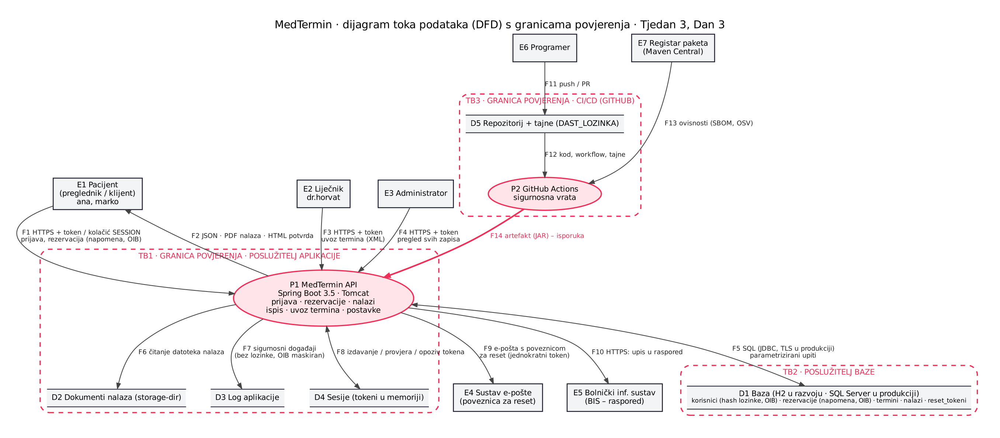

# Model prijetnji – dijagram toka podataka (DFD)

> Blok 3 radionice. Odgovor na prvo od četiri pitanja modeliranja prijetnji: **Što gradimo?**
> Drugo pitanje (*Što može poći po zlu?*) je [stride.md](stride.md), treće (*Što ćemo poduzeti?*)
> [registar-rizika.md](registar-rizika.md), a četvrto (*Jesmo li to dobro napravili?*) sigurnosni testovi i
> [plan-ispitivanja.md](plan-ispitivanja.md).

Izvor dijagrama je [dfd.dot](dfd.dot) (Graphviz): `dot -Tpng -Gdpi=150 docs/dfd.dot -o docs/dfd.png`.
Isti dijagram može se nacrtati u draw.io / diagrams.net ili OWASP Threat Dragon – važni su elementi, oznake
tokova i granice, ne alat.

## Elementi

| ID | Element | Vrsta | U kodu / okolini |
|---|---|---|---|
| E1 | Pacijent (ana, marko) | vanjski entitet | preglednik ili klijent API-ja |
| E2 | Liječnik (dr.horvat) | vanjski entitet | uloga `LIJECNIK` – uvoz termina |
| E3 | Administrator | vanjski entitet | uloga `ADMIN` – vidi sve zapise |
| E4 | Sustav e-pošte | vanjski entitet | `PostaService` (u laboratoriju datoteke u `data/posta`) |
| E5 | Bolnički informacijski sustav (BIS) | vanjski entitet | `BolnickiSustavKlijent` – upis u raspored |
| E6 | Programer | vanjski entitet | push i pull request |
| E7 | Registar paketa (Maven Central) | vanjski entitet | ovisnosti iz `pom.xml` |
| P1 | MedTermin API | proces | Spring Boot 3.5, ugrađeni Tomcat |
| P2 | GitHub Actions | proces | `.github/workflows/devsecops.yml` |
| D1 | Baza | spremište | H2 u razvoju; u produkciji SQL Server (Dan 2, laboratorij) |
| D2 | Dokumenti nalaza | spremište | `app.storage-dir` |
| D3 | Log aplikacije | spremište | konzola / datoteka poslužitelja |
| D4 | Sesije | spremište | `TokenStore` (memorija) |
| D5 | Repozitorij + tajne | spremište | GitHub, secret `DAST_LOZINKA` |

## Granice povjerenja

| ID | Granica | Što se na njoj kontrolira |
|---|---|---|
| TB1 | Internet ↔ poslužitelj aplikacije | autentikacija (token, istek – N-01), autorizacija po zapisu, provjera ulaza, CORS, kodiranje izlaza |
| TB2 | Poslužitelj aplikacije ↔ poslužitelj baze | račun aplikacije s minimalnim ovlastima, TLS, RLS/šifriranje (Dan 2) |
| TB3 | CI/CD (GitHub) ↔ ostatak svijeta | tko smije na `main`, ovlasti workflowa (`permissions:`), tajne, provjera ovisnosti |
| – | Poslužitelj ↔ E4, E5 | odlazni pozivi: TLS, provjera certifikata, što šaljemo van (samo nužno) |

Svaka strelica koja prelazi granicu (F1–F5, F9, F10, F12–F14) mjesto je za kontrolu – u [stride.md](stride.md) je
za svaku navedena prijetnja i kontrola.

## Tokovi podataka

| ID | Od → do | Podaci | Kako |
|---|---|---|---|
| F1 | E1 → P1 | prijava, rezervacija (napomena, OIB) | HTTPS, `Authorization: Bearer` ili kolačić `SESSION` |
| F2 | P1 → E1 | JSON, PDF nalaza, HTML potvrda za ispis | HTTPS; ispis s CSP-om |
| F3 | E2 → P1 | uvoz termina (XML) | HTTPS + token liječnika |
| F4 | E3 → P1 | pregled svih zapisa | HTTPS + token administratora |
| F5 | P1 ↔ D1 | svi zapisi | JDBC, parametrizirani upiti; TLS u produkciji |
| F6 | P1 → D2 | datoteke nalaza | čitanje samo po imenu iz baze |
| F7 | P1 → D3 | sigurnosni događaji | bez lozinke, OIB maskiran (`*******6504`) |
| F8 | P1 ↔ D4 | tokeni prijave | izdavanje, provjera, opoziv |
| F9 | P1 → E4 | poveznica za promjenu lozinke | jednokratni token, 15 minuta |
| F10 | P1 → E5 | upis u raspored | HTTPS (u laboratoriju simulacija) |
| F11 | E6 → D5 | kod | push / PR |
| F12 | D5 → P2 | kod, workflow, tajne | tajna samo u poslu DAST |
| F13 | E7 → P2 | ovisnosti | SBOM (CycloneDX) + OSV-Scanner |
| F14 | P2 → P1 | artefakt (JAR) | isporuka – kompromitiran pipeline = kompromitirana aplikacija |

## Na što paziti pri crtanju

- **Opskrbni lanac je dio sustava:** F14 ulazi u poslužitelj aplikacije. Zato su CI/CD i registar paketa u istom
  modelu kao aplikacija.
- **Log i sesije su spremišta**, ne „sporedne stvari“: u logu su bili lozinka i OIB (S12), a sesije bez isteka
  bile su nalaz N-01.
- Tko je na Danu 1 uveo Keycloak, dodaje ga kao vanjski entitet (prijava s PKCE, API dohvaća JWKS).
